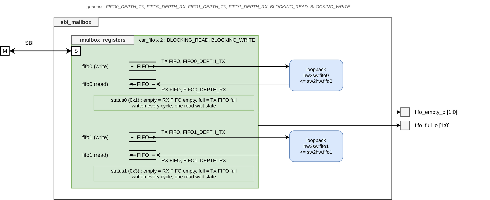

<!--
  README MODEL (common to every Asylum IP, keep the same headings)
  ----------------------------------------------------------------
  Regenerate from the sources, never from the previous README text alone:
    hdl/*.vhd (entities, generics, ports), hdl/csr/*.hjson (register map),
    <IP>.core (VLNV, targets, depends), mk/targets.txt, sim/, syn/, esw/.
  Sections, in this order:
    badges / title + one-line pitch / Overview / Features / Block Diagram /
    Getting Started / Hardware Interfaces / Configuration / Resources /
    Theory of Operation / Registers / Programmer's Guide /
    Design Verification / Dependencies and Related IPs / License
  Rules:
    - English, short and factual: every statement backed by the sources.
    - No VLNV line: the version badge shows it.
    - Badges: first line version, license; second line CI, lint, sim, syn.
    - Block diagram and FSM: pages Overview and FSM of doc/<NAME>.drawio, exported to
      doc/<NAME>-Overview.png and doc/<NAME>-FSM.png (make -C doc).
    - Timing diagrams: WaveDrom source doc/<NAME>-<what>.json, rendered
      doc/<NAME>-<what>.svg (make -C doc), shown as images.
    - No CPU named (OpenBlaze, PicoBlaze, RISC-V) outside the CPU and SoC IPs.
    - Registers: link to the generated hdl/csr/<X>_csr.md, never copy the tables.
    - Tables: Configuration = Name|Type|Default|Description,
      Hardware Interfaces = Name|Direction|Type|Description, grouped by interface.
    - A section with nothing to say is one line ("This IP has no
      software-visible registers."), never removed.
-->
[](https://github.com/deuskane/asylum-system-mailbox/tags)
[](LICENSE)

[](https://github.com/deuskane/asylum-system-mailbox/actions/workflows/ci.yml)
[](https://github.com/deuskane/asylum-system-mailbox/actions/workflows/ci.yml)
[](https://github.com/deuskane/asylum-system-mailbox/actions/workflows/ci.yml)
[](https://github.com/deuskane/asylum-system-mailbox/actions/workflows/ci.yml)

# Mailbox

**A small, readable mailbox in VHDL: two byte channels made of FIFOs, blocking or non blocking accesses, status registers and status outputs for an interrupt controller.**

Part of the [Asylum project](https://github.com/deuskane/asylum-project), a collection of small IP cores, written to be read and learned from.

## Table of Contents

1. [Overview](#overview)
2. [Features](#features)
3. [Block Diagram](#block-diagram)
4. [Getting Started](#getting-started)
5. [Hardware Interfaces](#hardware-interfaces)
6. [Configuration](#configuration)
7. [Resources](#resources)
8. [Theory of Operation](#theory-of-operation)
9. [Registers](#registers)
10. [Programmer's Guide](#programmers-guide)
11. [Design Verification](#design-verification)
12. [Dependencies and Related IPs](#dependencies-and-related-ips)
13. [License](#license)

## Overview

This IP lets software pass bytes from a producer to a consumer that share the bus: two tasks, an interrupt handler and the main loop. It has two independent channels, `fifo0` and `fifo1`: a byte written to a channel is read back, in order, from the same channel. Software drives the IP through four 8-bit registers on the SBI bus (the simple bus of Asylum): the two channels and their status. The status flags are also outputs, to raise an interrupt when a byte is available.

## Features

- 2 independent 8-bit channels, `fifo0` (address 0x0) and `fifo1` (0x2)
- Each channel is a TX FIFO looped back into an RX FIFO: capacity `DEPTH_TX + DEPTH_RX` bytes, each depth 0 (no FIFO) or a power of 2
- Blocking accesses (default): a read of an empty channel or a write in a full channel waits (bus `ready` low)
- Non blocking accesses (`BLOCKING_READ` / `BLOCKING_WRITE = false`): the access completes at once, a read of an empty channel pops nothing, a write in a full channel is dropped
- Status registers `status0` (0x1) and `status1` (0x3): `empty` and `full` flags, never blocking
- Status outputs `fifo_empty_o` / `fifo_full_o`, same flags, e.g. interrupt sources of the Asylum GIC
- Depths checked at elaboration (0 or a power of 2, not both 0 in a channel)

## Block Diagram



## Getting Started

The cores of the Asylum IPs are published in the FuseSoC library [asylum-cores](https://github.com/deuskane/asylum-cores) (with the UVVM core used by the testbench):

```bash
pip install fusesoc
fusesoc library add https://github.com/deuskane/asylum-cores
fusesoc run --target sim_mailbox_4_4_fill asylum:system:mailbox  # needs GHDL
```

To use the IP in your design, add `asylum:system:mailbox` to the `depend` list of your core and instantiate `sbi_mailbox` (library `asylum`):

```vhdl
library asylum;
use     asylum.sbi_pkg.all;
use     asylum.mailbox_pkg.all;

  ins_mailbox : sbi_mailbox
    generic map
    ( NAME           => "MAILBOX0"
     ,FIFO0_DEPTH_TX => 4
     ,FIFO0_DEPTH_RX => 4
     ,FIFO1_DEPTH_TX => 4
     ,FIFO1_DEPTH_RX => 4
    )
    port map
    ( clk_i        => clk
     ,arst_b_i     => arst_b
     ,sbi_ini_i    => sbi_ini       -- 2 address bits, 8-bit data
     ,sbi_tgt_o    => sbi_tgt
     ,fifo_empty_o => mailbox_empty -- not mailbox_empty(n) : byte available in fifo<n>
     ,fifo_full_o  => open
    );
```

[PicoSoC](https://github.com/deuskane/asylum-soc-picosoc) is a complete example: `not fifo_empty_o` drives two sources of its interrupt controller, with the software macros [esw/include/mailbox.h](https://github.com/deuskane/asylum-soc-picosoc/blob/main/esw/include/mailbox.h).

## Hardware Interfaces

Top-level entity: **`sbi_mailbox`** ([hdl/sbi_mailbox.vhd](hdl/sbi_mailbox.vhd)), component in `asylum.mailbox_pkg`.

### Clock and Reset

| Name | Direction | Type | Description |
|------|-----------|------|-------------|
| `clk_i` | in | std_logic | System clock, the only clock of the IP |
| `arst_b_i` | in | std_logic | Asynchronous reset, active low: both channels are emptied |

### Bus (SBI)

| Name | Direction | Type | Description |
|------|-----------|------|-------------|
| `sbi_ini_i` | in | sbi_ini_t | Request from the initiator (`cs`, `re`, `we`, `addr`, `wdata`); 2 address bits, 8-bit data |
| `sbi_tgt_o` | out | sbi_tgt_t | Response to the initiator (`ready`, `rdata`, `info`); `ready` low while a blocking access waits |

### Status

| Name | Direction | Type | Description |
|------|-----------|------|-------------|
| `fifo_empty_o` | out | std_logic_vector(1 downto 0) | Bit n: no byte to read in `fifo<n>`, same flag as `status<n>.empty`; 1 after reset |
| `fifo_full_o` | out | std_logic_vector(1 downto 0) | Bit n: no free slot in `fifo<n>`, same flag as `status<n>.full` |

The status outputs are combinational from the FIFO flags (the status registers sample them). They can be left open. They are levels: an interrupt on `not fifo_empty_o(n)` stays active until software has read every byte of the channel.

## Configuration

Generics of `sbi_mailbox`:

| Name | Type | Default | Description |
|------|------|---------|-------------|
| `NAME` | string | `""` | Instance name, visible in `sbi_tgt_o.info` (`"mailbox"` when empty) |
| `FIFO0_DEPTH_TX` | natural | *(none)* | Depth of the TX FIFO of `fifo0` (written by software): 0 (no FIFO) or a power of 2 |
| `FIFO0_DEPTH_RX` | natural | *(none)* | Depth of the RX FIFO of `fifo0` (read by software): 0 (no FIFO) or a power of 2 |
| `FIFO1_DEPTH_TX` | natural | *(none)* | Depth of the TX FIFO of `fifo1`: 0 or a power of 2 |
| `FIFO1_DEPTH_RX` | natural | *(none)* | Depth of the RX FIFO of `fifo1`: 0 or a power of 2 |
| `BLOCKING_READ` | boolean | `true` | `true`: a read of an empty channel waits for a byte; `false`: it completes at once, the data is not valid and nothing is popped |
| `BLOCKING_WRITE` | boolean | `true` | `true`: a write in a full channel waits for a free slot; `false`: it completes at once and the byte is dropped |

A depth that is neither 0 nor a power of 2, or a channel with both depths 0, stops the elaboration (assertion, severity failure). A depth of 1 needs `asylum:component:fifo` >= 1.2.1. The FIFO depths set most of the area of the IP.

## Resources

Figures of the `syn_*` targets (`make nonreg_syn`, see [Targets](#targets)): [syn/sbi_mailbox_wrapper.vhd](syn/sbi_mailbox_wrapper.vhd) with the FIFO depths of each configuration (blocking accesses: the wrapper does not set `BLOCKING_READ` / `BLOCKING_WRITE`), synthesized by Yosys and its GHDL plugin; the reports are in the build directory of each target. FIFO depths as FIFO0 TX / RX, FIFO1 TX / RX.

| Configuration | LUT¹ | LUTRAM¹ | FF¹ | CARRY4¹ | MUXF7/F8¹ | BRAM¹ | DSP¹ | Area² (µm²) | kGE³ |
|---|---|---|---|---|---|---|---|---|---|
| `syn_default` (FIFOs 4/4/4/4) | 79 | 32 | 30 | 8 | 13 | 0 | 0 | 6322.31 | 1.684 |
| `syn_depth0` (FIFOs 0/4/2/0) | 51 | 16 | 16 | 2 | 7 | 0 | 0 | 2630.02 | 0.701 |
| `syn_depth2_8` (FIFOs 2/2/8/2) | 71 | 32 | 26 | 2 | 6 | 0 | 0 | 5458.99 | 1.454 |
| `syn_depth1` (FIFOs 1/1/1/0) | 38 | 0 | 36 | 0 | 0 | 0 | 0 | 1347.54 | 0.359 |

¹ Xilinx Artix-7 (LUT6), Yosys 0.33 `synth_xilinx -flatten -noiopad -noclkbuf`, before place and route: every cell of the netlist is counted, Vivado may differ. An `INV` counts as a `LUT1` (38 of the 79 LUTs of `syn_default`). The FIFO storage is in LUTRAM (`RAM32M`, 4 LUTs each), not in BRAM; with a depth of 1 the storage is a register (`syn_depth1`: no LUTRAM, 24 of its 36 flip-flops).

² SkyWater sky130 `sky130_fd_sc_hd`, typical corner (tt, 25 °C, 1.80 V), Yosys 0.33 `synth` + `dfflibmap` + `abc -liberty`: standard-cell area only, no timing constraint, no buffering, clock tree or placement; the FIFO storage becomes flip-flops (no SRAM macro).

³ Area in thousands of NAND2 gate equivalents (`sky130_fd_sc_hd__nand2_1` = 3.7536 µm²).

## Theory of Operation

### Hierarchy

| File | Unit | Role |
|------|------|------|
| [hdl/sbi_mailbox.vhd](hdl/sbi_mailbox.vhd) | `sbi_mailbox` | Top level: register bank, loopback of each channel, status flags, checks of the depths |
| [hdl/mailbox_pkg.vhd](hdl/mailbox_pkg.vhd) | `mailbox_pkg` | Component `sbi_mailbox` |
| `hdl/csr/mailbox_csr.vhd` | `mailbox_registers` | Register bank, generated by regtool from [hdl/csr/mailbox.hjson](hdl/csr/mailbox.hjson): one `csr_fifo` per channel, one `csr_reg` per status register |

### Channels

`fifo0` and `fifo1` are `fifo` registers of regtool (`csr_fifo` of `asylum:utils:generators`): a software write pushes the byte in a TX FIFO (depth `FIFO<n>_DEPTH_TX`), a software read pops a byte from an RX FIFO (depth `FIFO<n>_DEPTH_RX`). `sbi_mailbox` connects the output of the TX FIFO to the input of the RX FIFO of the same channel (valid, data and ready): the bytes move from one FIFO to the other without software, a few cycles after the write. A channel therefore holds up to `DEPTH_TX + DEPTH_RX` bytes, read in the order they were written. The two channels share nothing but the bus.

A depth of 0 removes that FIFO: with `DEPTH_TX = 0` the write goes straight into the RX FIFO, with `DEPTH_RX = 0` the read takes the byte at the output of the TX FIFO. With both depths 0 a write could only complete during a simultaneous read of the same channel, which a single bus port cannot do: `sbi_mailbox` refuses this configuration at elaboration.

### Blocking and non blocking accesses

| Access | Blocking (default) | Non blocking |
|--------|--------------------|--------------|
| Read of an empty channel | waits (`ready` low) until a byte arrives | completes at once, data not valid, nothing popped |
| Write in a full channel | waits until a slot is free | completes at once, the byte is dropped |

The only way to fill or drain a channel is another access on the same bus: a blocking access to an empty or full channel waits forever and holds the bus. Software reads the status first (see [Programmer's Guide](#programmers-guide)).

### Status

`status<n>.empty` is the empty flag of the RX FIFO (of the TX FIFO output when `DEPTH_RX = 0`), `status<n>.full` the full flag of the TX FIFO (of the RX FIFO input when `DEPTH_TX = 0`): exactly the conditions that make an access wait or fail. `full` is the flag of the TX FIFO, not of the whole channel: a write right after another one can find the TX FIFO full while the RX FIFO still has room. A blocking write then waits a few cycles, a non blocking write is dropped.

The status registers are written by the hardware every cycle, so they sample the flags one cycle late; their read wait state (`rd_wait_state: 1`) makes a read right after a write or a read of the channel return the flags updated by that access. A write of a status register is ignored. `fifo_empty_o` / `fifo_full_o` are the same flags, without the register.

## Registers

Four 8-bit registers (2 address bits): `fifo0` (0x0), `status0` (0x1), `fifo1` (0x2), `status1` (0x3).

- Register documentation: **[hdl/csr/mailbox_csr.md](hdl/csr/mailbox_csr.md)**
- C header: [hdl/csr/mailbox_csr.h](hdl/csr/mailbox_csr.h)
- Source: [hdl/csr/mailbox.hjson](hdl/csr/mailbox.hjson) (regtool)

## Programmer's Guide

### Never stall the bus

- Read `fifo<n>` only when `status<n>.empty = 0`, write it only when `status<n>.full = 0`: the status registers are never blocking.
- A channel has one producer and one consumer: between the status read and the access, only the other side can move, and it only frees a slot (for the producer) or adds a byte (for the consumer).
- With non blocking accesses the same rule tells whether the access is valid: a read with `empty = 1` returns a non valid data, a write with `full = 1` is lost.
- For an interrupt, use `not fifo_empty_o(n)` as a level source and read the channel until `empty = 1` in the handler.

### Example: send and receive bytes

The registers are 8 bits wide, at consecutive byte addresses from the base address of the IP (`0x40000000` is an example, use the address map of your SoC).

```c
#include <stdint.h>
#include "mailbox_csr.h"

#define MAILBOX_BASE ((uintptr_t)0x40000000u)   // example base address

static inline void reg_wr(uint32_t offset, uint8_t data)
{
  *(volatile uint8_t *)(MAILBOX_BASE + offset) = data;
}

static inline uint8_t reg_rd(uint32_t offset)
{
  return *(volatile uint8_t *)(MAILBOX_BASE + offset);
}

// Producer: write a byte in fifo0, 0 if the channel is full
int mailbox_send(uint8_t data)
{
  if (reg_rd(MAILBOX_STATUS0) & (1 << MAILBOX_STATUS0_FULL))
    return 0;
  reg_wr(MAILBOX_FIFO0, data);
  return 1;
}

// Consumer: read a byte from fifo0, 0 if the channel is empty
int mailbox_receive(uint8_t *data)
{
  if (reg_rd(MAILBOX_STATUS0) & (1 << MAILBOX_STATUS0_EMPTY))
    return 0;
  *data = reg_rd(MAILBOX_FIFO0);
  return 1;
}
```

`fifo1` is used the same way (`MAILBOX_FIFO1`, `MAILBOX_STATUS1`), e.g. for the answers.

## Design Verification

### Testbenches

| File | DUT | Description |
|------|-----|-------------|
| [sim/mailbox/tb_mailbox.vhd](sim/mailbox/tb_mailbox.vhd) | `sbi_mailbox` | Self-checking UVVM testbench with the SBI BFM, generics `TESTS_LIST` (scenarios, see below) and those of the DUT (`FIFO<n>_DEPTH_TX/RX`, `BLOCKING_READ`, `BLOCKING_WRITE`). A model of each channel (the bytes written and not read yet) gives the expected bytes, the status registers and the status outputs. An access of an empty / full channel is checked by hand: blocking, `ready` stays low during 16 cycles, then the testbench releases the access (it is the only initiator: nothing can unblock it); non blocking, the access completes without wait state. With non blocking accesses, every read polls `status.empty` and every write polls `status.full` first. Every completed access has at most 4 wait states. Scenarios in `tb_mailbox_<name>_pkg`, names and dispatch in [tb_mailbox_tests_pkg](sim/mailbox/tb_mailbox_tests_pkg.vhd), helpers (register accesses, channel model, status checks, reset pulse) in [tb_mailbox_bfm_pkg](sim/mailbox/tb_mailbox_bfm_pkg.vhd) |

### Scenarios (`TESTS_LIST`)

The scenarios are chosen at run time with the generic `TESTS_LIST`: names separated by `,` without space (`fill,random,fill`), a name may be repeated. The sequencer first checks every name (an unknown name is a `TB_ERROR` before any scenario runs), then for each scenario drives a reset pulse with the bus inactive, logs `TEST <i>/<N> : <name>` and runs it: each scenario starts from reset. The empty list (default) only compiles and elaborates the testbench. The list is parsed and its names checked with `list_length` / `list_item` / `list_contains` of `asylum.string_pkg` (`asylum:utils:pkg` >= 1.10.0).

Checks counted as the `=> OK` lines of the log, FIFO depths 4/4/4/4, blocking accesses:

| Name | Checks | Description |
|------|--------|-------------|
| `reset_values` | 14 | Each channel after reset: `status<n>` = empty, `fifo_empty_o(n) = 1`, `fifo_full_o(n) = 0`; a read of the empty channel waits (or completes, non blocking) and changes nothing |
| `fill` | 86 | Each channel: fill it with the status after each write, a write in the full channel waits (or is dropped), read back in order, status read right after the last read (read wait state), read of the drained channel |
| `write_read` | 8 | Each channel: a byte read just after its write, 4 times (the blocking read waits for the byte to reach the RX FIFO) |
| `random` | 213 | Each channel: 200 random writes and reads against the model, then drained and empty |
| `independent` | 28 | `fifo0` full while `fifo1` is empty, then used: status and outputs of both, `fifo0` read back unchanged |
| `status_write` | 30 | Writes of `status<n>` (channel empty, then full) change neither the register nor the channel |
| `async_reset` | 19 | Both channels full, reset asserted between two clock edges: `fifo_empty_o` / `fifo_full_o` reset at once; then empty status and channels, a write and a read |

### Targets

| Target | Toplevel | Description |
|--------|----------|-------------|
| `default` | `sbi_mailbox` | HDL fileset + CSR generation (not a simulation) |
| `sim_mailbox_4_4` | `tb_mailbox` | Reference configuration (FIFO depths 4/4/4/4, blocking accesses): build and elaboration only (`TESTS_LIST` empty), base of the scenario targets and of the list runs |
| `sim_mailbox_4_4_<name>` | `tb_mailbox` | One target per scenario: `sim_mailbox_4_4_reset_values`, `_fill`, `_write_read`, `_random`, `_independent`, `_status_write`, `_async_reset` (398 checks in all) |
| `sim_mailbox_depth0` | `tb_mailbox` | FIFO0 TX 0 / RX 4, FIFO1 TX 2 / RX 0 (one FIFO removed per channel), every scenario (340 checks) |
| `sim_mailbox_2_8` | `tb_mailbox` | FIFO0 TX 2 / RX 2, FIFO1 TX 8 / RX 2, every scenario (384 checks) |
| `sim_mailbox_depth1` | `tb_mailbox` | FIFO0 TX 1 / RX 1, FIFO1 TX 1 / RX 0 (single-word FIFOs), every scenario (322 checks) |
| `sim_mailbox_nonblocking` | `tb_mailbox` | Non blocking read and write, FIFO0 TX 4 / RX 0, FIFO1 TX 0 / RX 2, every scenario (803 checks) |
| `sim_mailbox_nonblocking_write` | `tb_mailbox` | Blocking read, non blocking write, FIFO depths 4/4/4/4, every scenario (669 checks) |
| `lint_ghdl` | `asylum.sbi_mailbox_wrapper` | GHDL `-Wall` analysis and elaboration of [syn/sbi_mailbox_wrapper.vhd](syn/sbi_mailbox_wrapper.vhd) (`sbi_mailbox` with flat SBI ports) |
| `lint_ghdl_synth_<config>` | `asylum.sbi_mailbox_wrapper` | `ghdl --synth` check (no latch, synthesizable) for 4 FIFO depth configurations: `default` (4/4/4/4), `depth0` (0/4/2/0), `depth2_8` (2/2/8/2), `depth1` (1/1/1/0) |
| `syn_<config>` | `asylum.sbi_mailbox_wrapper` | Synthesis with Yosys, Artix-7 and sky130 (see [Resources](#resources)), same 4 configurations as `lint_ghdl_synth_<config>`: `syn_default`, `syn_depth0`, `syn_depth2_8`, `syn_depth1` |

The reference configuration of a testbench has a build-only base target and one target per scenario: one CI job per scenario, a failure is isolated. Every other configuration has one target that runs its whole list: the `TEST <i>/<N>` header names a failing scenario. FuseSoC replaces the `parameters` list of an inherited target, so each target repeats the generics of its configuration.

Every `sim_*`, `lint_*` and `syn_*` target is a job of the [GitHub CI](https://github.com/deuskane/asylum-system-mailbox/actions/workflows/ci.yml), run in the [asylum-env](https://github.com/deuskane/asylum-ci) image (GHDL, FuseSoC, UVVM, Yosys). The `sim`, `lint` and `syn` badges count the passed and failed targets of the last run on `main`.

### How to Run

From a clone of [asylum-project](https://github.com/deuskane/asylum-project) (GHDL and FuseSoC installed, or in the asylum-env image):

```bash
make help                        # variables, rules and targets
make sim_mailbox_4_4_fill        # one scenario, log in log/
make sim_mailbox_nonblocking     # every scenario of a configuration
make nonreg_sim                  # every sim_* target
make nonreg_lint                 # every lint_* target
make nonreg_syn                  # every syn_* target (Yosys, figures of Resources)
make TARGETS_FILTER=^sim_mailbox_4_4 nonreg_sim
```

To run a list of scenarios, build the testbench once, then run the list without recompiling, either with FuseSoC (same `--build-root` and `--no-export` as the Makefile, so that the build of the target is reused; any generic of the target can be overridden after the VLNV):

```bash
make sim_mailbox_4_4             # build and elaboration (TESTS_LIST empty)
fusesoc --cores-root . run --build-root build --no-export --run --target sim_mailbox_4_4 asylum:system:mailbox:1.1.0 --TESTS_LIST=fill,random,fill
```

or in the build directory of the target. `EXTRA_OPTIONS` replaces every generic set by the target: repeat the generics of the configuration, else their default values apply:

```bash
cd build/asylum_system_mailbox_1.1.0/sim_mailbox_4_4-ghdl
make run EXTRA_OPTIONS="-gTESTS_LIST=fill,random -gFIFO0_DEPTH_TX=4 -gFIFO0_DEPTH_RX=4 -gFIFO1_DEPTH_TX=4 -gFIFO1_DEPTH_RX=4"
```

To add a scenario: a `tb_mailbox_<name>_pkg` package with its procedure `run` (in the `sim` fileset), its name in `C_TESTS` and its case in `run_test` of [tb_mailbox_tests_pkg](sim/mailbox/tb_mailbox_tests_pkg.vhd), a `sim_mailbox_4_4_<name>` target and the name in the `TESTS_LIST` of the other configurations in [mailbox.core](mailbox.core), then `make mk/targets.txt` and `make ci_generate`.

Outside the CI, GHDL writes a waveform `dut.fst`.

## Dependencies and Related IPs

| Core | Repository | Purpose |
|------|------------|---------|
| `asylum:utils:generators` (>= 2.10.0) | [asylum-utils-generators](https://github.com/deuskane/asylum-utils-generators) | regtool (register generator) and the CSR building blocks (`csr_fifo`, `csr_reg` with read wait states) |
| `asylum:component:fifo` (>= 1.2.1 for a depth of 1) | [asylum-component-fifo](https://github.com/deuskane/asylum-component-fifo) | `fifo_sync`, the FIFOs of `csr_fifo` (dependency of `asylum:utils:generators`) |
| `asylum:utils:pkg` | [asylum-utils-pkg](https://github.com/deuskane/asylum-utils-pkg) | Common packages (`sbi_pkg`, `math_pkg`, ...); the testbench needs >= 1.10.0 (`string_pkg` lists of `TESTS_LIST`) |
| `asylum:utils:ghdl_synth` | [asylum-utils-generators](https://github.com/deuskane/asylum-utils-generators) | `ghdl --synth` check of the `lint_ghdl_synth_*` targets |
| `asylum:utils:yosys_synth` | [asylum-utils-generators](https://github.com/deuskane/asylum-utils-generators) | Yosys synthesis of the `syn_*` targets (Artix-7 and sky130) |
| `bitvis:verification:uvvm` | [UVVM](https://github.com/UVVM/UVVM) | Verification library and SBI BFM |

Used by [asylum-soc-picosoc](https://github.com/deuskane/asylum-soc-picosoc). Other system IPs of Asylum: [GIC](https://github.com/deuskane/asylum-system-gic) (interrupt controller, sources `not fifo_empty_o`), [spinlock](https://github.com/deuskane/asylum-system-spinlock). All the IPs: [asylum-project](https://github.com/deuskane/asylum-project).

## License

Apache License 2.0, see [LICENSE](LICENSE).
